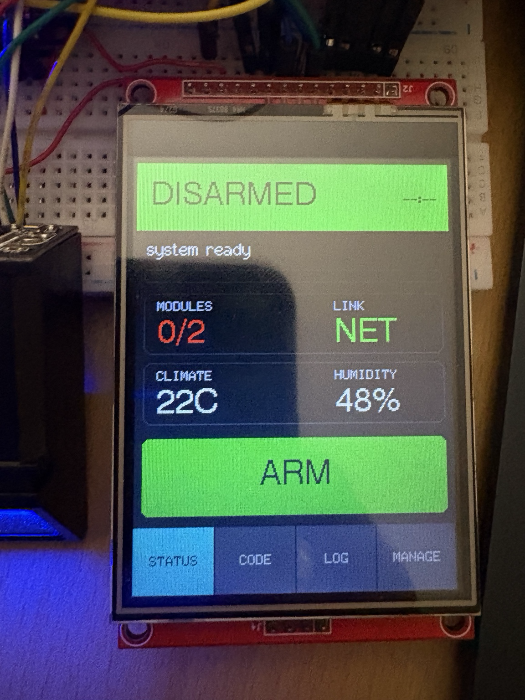
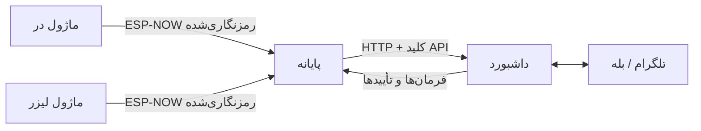
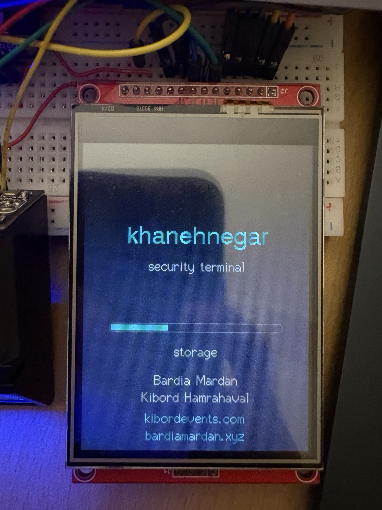
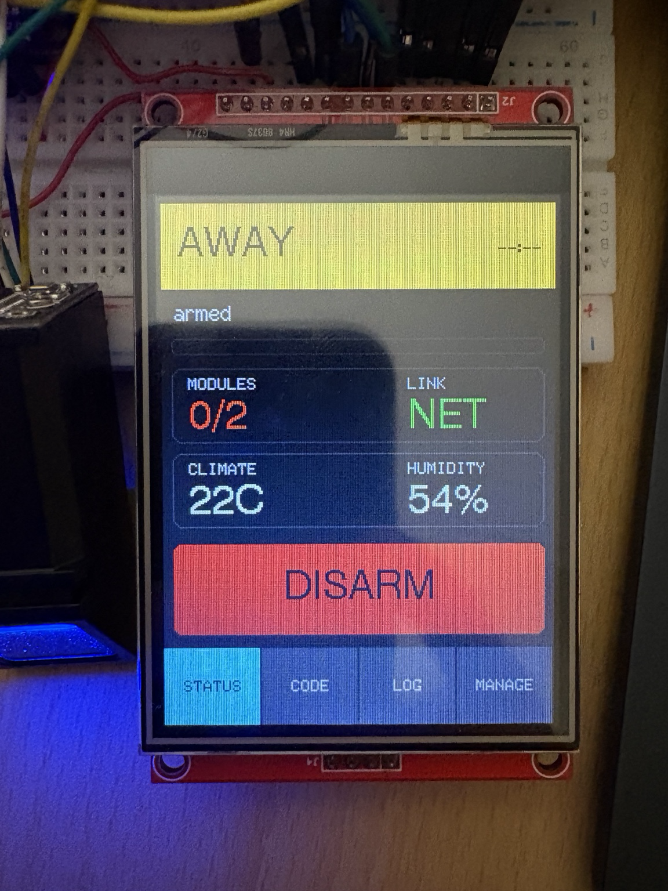
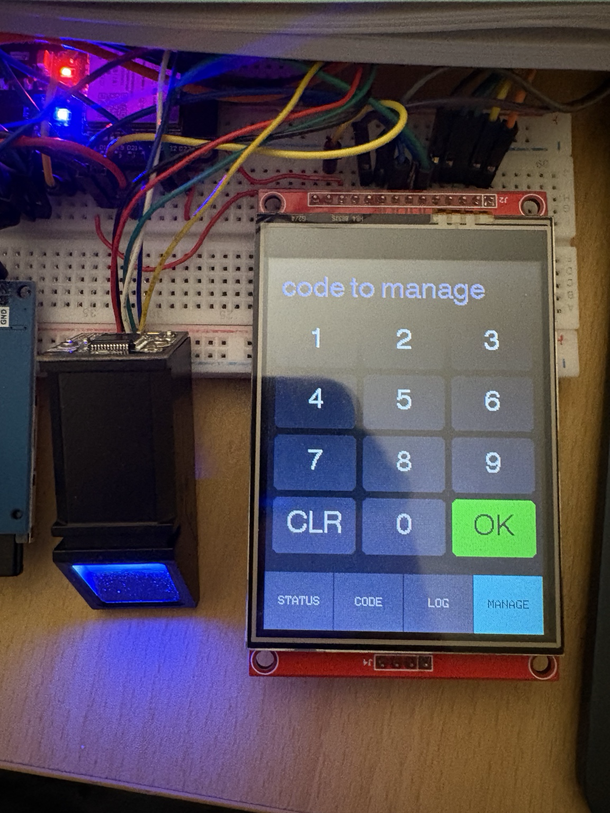
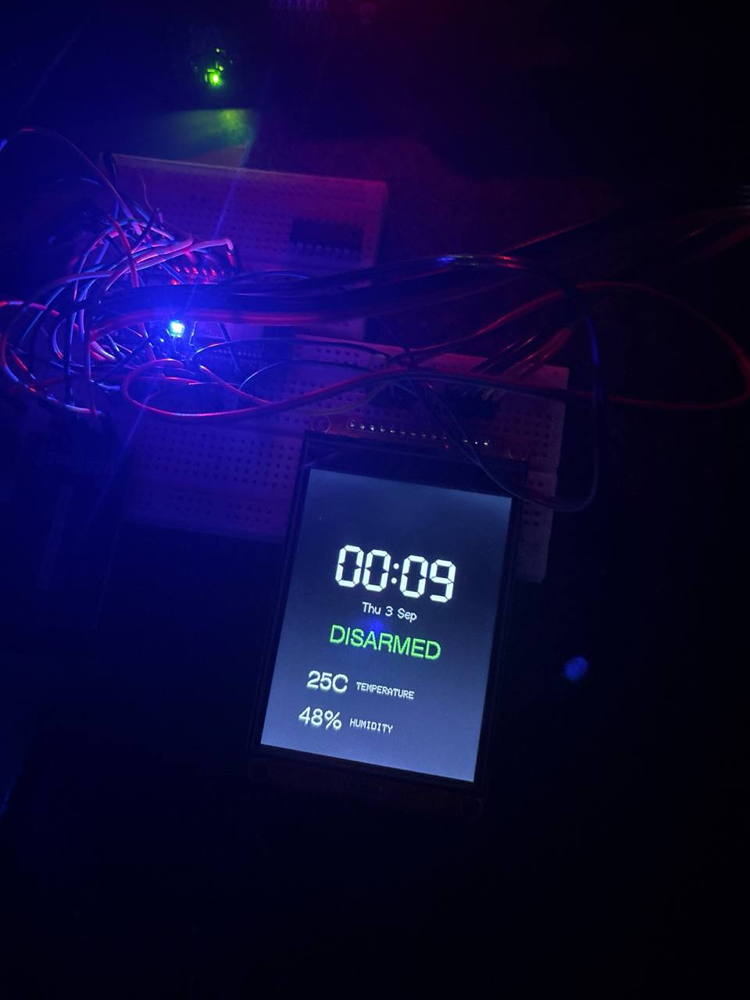

<div dir="rtl">

<div align="center">

# خانه‌نگر · khanehnegar

**یک سیستم امنیتی ماژولار و خودمیزبان برای خانه، ساخته‌شده با ESP32.**
سنسورهای بی‌سیم رمزنگاری‌شده، پایانه‌ای با صفحه لمسی و حسگر اثر انگشت که خودش تصمیم می‌گیرد، و داشبورد وب دوزبانه با هشدار در تلگرام و بله.

[](https://github.com/BardiaMardan/khanehnegar-security/actions/workflows/ci.yml)
[](LICENSE)

[English](README.md) · **فارسی**



</div>

---

## خانه‌نگر چیست

خانه‌نگر یک سیستم دزدگیر کامل است که خودتان با قطعات رایج و ارزان می‌سازید.

**ماژول‌های حسگر** کوچک روی درها و در مسیر راهروها نصب می‌شوند و هرچه حس کنند را از طریق رادیوی رمزنگاری‌شده‌ی ESP-NOW گزارش می‌دهند. **پایانه‌ی مرکزی** (یک ESP32 با صفحه لمسی ۲٫۸ اینچی، حسگر اثر انگشت و صفحه‌کلید) این شواهد را می‌سنجد و تصمیم می‌گیرد آژیر را به صدا درآورد، **بی‌صدا** به شما خبر دهد، یا فقط آن را ثبت کند. **داشبورد وب** روی سیستم خودتان اجرا می‌شود، تاریخچه را نگه می‌دارد، فرمان‌ها را منتقل می‌کند و هشدارها را به گوشی‌تان می‌فرستد.

پایانه برای محافظت از خانه به اینترنت، حساب ابری یا حتی داشبورد نیازی ندارد. بقیه‌ی بخش‌ها اختیاری‌اند.

## امکانات

**پایانه**
- رابط لمسی ۲٫۸ اینچی: وضعیت، صفحه‌کلید، گزارش رویدادها، مدیریت و ساعت حالت آماده‌به‌کار
- غیرفعال‌سازی با **اثر انگشت** (R307/R308) یا **رمز عددی**. رمز به صورت SHA-256 نمک‌دار ذخیره و در زمان ثابت مقایسه می‌شود.
- **قفل کامل** پس از ۵ رمز اشتباه. با ری‌استارت پاک نمی‌شود و فقط با اثر انگشت شناخته‌شده یا از راه دور باز می‌شود.
- **موتور ترکیب ریسک** با شواهد *پرصدا* و *بی‌صدا*، به‌همراه تأخیر خروج و ورود
- حالت مسلح پس از قطع برق حفظ می‌شود. ۴۰ رویداد آخر در حافظه‌ی فلش و تاریخچه‌ی کامل روی کارت SD ذخیره می‌شود.
- شبکه روی هسته‌ی جداگانه اجرا می‌شود، پس سرور کند هیچ‌وقت صفحه را قفل نمی‌کند.

**ماژول‌های حسگر**
- **در**: شتاب‌سنج باز شدن، ضربه و دستکاری در را تشخیص می‌دهد. لمس دستگیره یک ماشه‌ی *بی‌صدا* است.
- **لیزر**: پرتو به صورت چشمک‌زن اندازه‌گیری می‌شود، پس نور محیط یا چراغ‌قوه نمی‌تواند قطع شدن آن را پنهان کند.
- ضربان هر ۵ ثانیه. اگر ماژولی خاموش یا تخریب شود، ظرف ۱۳ ثانیه هشدار **MODULE LOST** صادر می‌شود.

**کتابخانه‌ی رادیویی SecMesh**
- ESP-NOW با رمزنگاری CCMP، شمارنده‌ی ضدتکرار برای هر ماژول و فیلتر آدرس MAC
- جفت‌سازی با پیام همگانی، جست‌وجوی خودکار کانال و شمارنده‌هایی که در برابر ری‌استارت مقاوم‌اند
- پیام‌های فوری سه بار ارسال می‌شوند، پس گم شدن یک بسته هشدار را از بین نمی‌برد.

**داشبورد**
- Next.js 15، **فارسی (راست‌به‌چپ) و انگلیسی**، سازگار با موبایل
- فهرست زنده‌ی رویدادها و فرمان‌های **فعال‌سازی / غیرفعال‌سازی / وضعیت اضطراری / قفل / بازکردن قفل**
- مدیریت اثر انگشت: تغییر نام از وب، اما **حذف فقط با تأیید روی پایانه**
- هشدار و فرمان از طریق **تلگرام و بله**
- ورود فقط برای یک مدیر، ثبت‌نام بسته و محدودیت تعداد تلاش

## روش کار



۱. ماژول چیزی را حس می‌کند و آن را **سه بار** به صورت رمزنگاری‌شده می‌فرستد.
۲. پایانه پیام‌های تکراری و جعلی را دور می‌ریزد و به رویداد **امتیاز** می‌دهد. شواهد قوی، مثل باز شدن در یا قطع پرتو، به‌تنهایی آستانه‌ی هشدار را رد می‌کنند. شواهد ضعیف باید با هم جمع شوند.
۳. شواهد **پرصدا** آژیر را روشن می‌کنند. شواهد **بی‌صدا** (مثل دست روی دستگیره یا دستکاری یک ماژول) فقط به گوشی شما خبر می‌دهند تا مزاحم نفهمد دیده شده است.
۴. پایانه هشدار را به داشبورد می‌فرستد و داشبورد آن را ذخیره و به تلگرام و بله ارسال می‌کند.
۵. پایانه هر ۵ ثانیه از داشبورد فرمان‌های تازه را **می‌پرسد**، پس هیچ پورتی در شبکه‌ی شما رو به بیرون باز نمی‌شود.

جزئیات کامل با نمودار: **[docs/architecture.md](docs/architecture.md)**

## سخت‌افزار

| برد | قطعات |
|---|---|
| **پایانه** | ESP32 · صفحه لمسی ILI9341 ‏۲٫۸ اینچ · حسگر اثر انگشت R307/R308 · ماژول microSD · DHT11 · بازر |
| **ماژول در** | ESP32 · شتاب‌سنج ADXL345 · یک سیم به دستگیره‌ی در |
| **ماژول لیزر** | ESP32 (LilyGO T-Display) · ماژول لیزر · مقاومت نوری + ۱۰ کیلواهم · LED |

همه روی بردبورد و بدون لحیم‌کاری ساخته می‌شوند. جدول سیم‌کشی: **[docs/hardware.md](docs/hardware.md)**

## شروع سریع

به سخت‌افزار بالا، Arduino IDE 2 یا `arduino-cli` و Node.js 22 نیاز دارید.

| گام | آموزش |
|---|---|
| **۱.** سیم‌کشی پایانه، نصب هسته‌ی ESP32 و کتابخانه‌ها، تعیین کلیدها و آپلود | [۰۱ · پایانه](docs/tutorials/01-hub.md) |
| **۲.** وای‌فای و آدرس داشبورد روی کارت SD | [۰۲ · کارت SD](docs/tutorials/02-sd-card.md) |
| **۳.** ساخت و جفت‌سازی ماژول در | [۰۳ · ماژول در](docs/tutorials/03-door-node.md) |
| **۴.** ساخت و جفت‌سازی ماژول لیزر | [۰۴ · ماژول لیزر](docs/tutorials/04-laser-node.md) |
| **۵.** نصب و اجرای داشبورد | [۰۵ · داشبورد](docs/tutorials/05-dashboard.md) |
| **۶.** اتصال تلگرام و/یا بله | [۰۶ · هشدارها](docs/tutorials/06-alerts.md) |
| **۷.** تغییر رمز، ثبت اثر انگشت و آزمودن همه‌ی مسیرهای هشدار | [۰۷ · اولین اجرا](docs/tutorials/07-first-run.md) |

<div dir="ltr">

```bash
cd dashboard
cp .env.example .env.local
npm ci
npm run setup
npm run dev
```

</div>

> مستندات فنی به زبان انگلیسی هستند.

## مستندات

| | |
|---|---|
| **معماری** | [بخش‌ها، حالت‌ها، مسیر هشدار، تصمیم‌های طراحی](docs/architecture.md) |
| **سخت‌افزار** | [فهرست قطعات و سیم‌کشی](docs/hardware.md) |
| **پروتکل** | [قالب پیام SecMesh، جفت‌سازی، کدهای رویداد](docs/protocol.md) |
| **API** | [همه‌ی مسیرهای داشبورد](docs/api.md) |
| **پیکربندی** | [کارت SD، ‏`config.h`، ‏`.env`](docs/configuration.md) |
| **امنیت** | [مدل تهدید، محدودیت‌ها، چک‌لیست ایمن‌سازی](docs/security.md) |
| **استقرار** | [انتقال داشبورد به رزبری‌پای، سرور خانگی یا VPS](docs/deployment.md) |
| **عیب‌یابی** | [مشکلات رایج و پرسش‌های متداول](docs/troubleshooting.md) |

## تصمیم‌های طراحی

- **ESP-NOW به جای وای‌فای یا MQTT برای حسگرها.** ماژول‌ها به مودم وابسته نیستند، در چند میلی‌ثانیه دوباره وصل می‌شوند و رمزنگاری در لایه‌ی لینک انجام می‌شود.
- **پایانه تصمیم می‌گیرد و ماژول‌ها فقط گزارش می‌دهند.** رمزها و منطق هشدار در یک جا نگه داشته می‌شوند.
- **شواهد پرصدا و بی‌صدا.** آژیر از اموال محافظت می‌کند اما به مزاحم هم هشدار می‌دهد. بعضی نشانه‌ها اگر پنهان بمانند ارزشمندترند.
- **یک رویداد قوی کافی است.** در نفوذ واقعی کسی دو بار در را باز نمی‌کند.
- **کارهای مخرب از وب نیاز به تأیید روی پایانه دارند.** با رمز دزدیده‌شده‌ی داشبورد نمی‌توان اثر انگشت شما را حذف کرد.
- **پایانه سؤال می‌کند و هیچ اتصالی از بیرون وارد نمی‌شود.** نه پورت‌فورواردینگ لازم است، نه IP ثابت.
- **وضعیت امنیتی در حافظه‌ی فلش، تنظیمات روی کارت SD.** با بیرون کشیدن کارت نمی‌توان فهرست افراد مجاز را عوض کرد.

## امنیت و محدودیت‌ها

خانه‌نگر یک پروژه‌ی شخصی با طراحی دقیق است، **نه دزدگیر دارای گواهی**. صادقانه:

| ✅ در برابر این‌ها محافظت می‌کند | ⚠️ در برابر این‌ها محافظت نمی‌کند |
|---|---|
| باز یا شکسته شدن در، عبور از پرتو | پارازیت رادیویی (در ۱۳ ثانیه تشخیص داده می‌شود، اما هشدار به شبکه نیاز دارد) |
| شنود، جعل یا تکرار پیام حسگرها (ESP32) | قطع برق (نسخه‌ی مرجع باتری ندارد) |
| تخریب یا جدا کردن یک ماژول | قطع اینترنت (آژیر کار می‌کند، هشدار راه دور نه) |
| حدس زدن رمز و امتحان انگشت‌های ناشناس | ماژول‌های ESP8266 (پیام‌ها رمزنگاری نمی‌شوند) |
| قطع و وصل برق برای غیرفعال کردن | یک کلید مشترک برای همه‌ی بردها |
| بیرون کشیدن کارت SD | ارتباط پایانه و داشبورد بدون HTTPS رمزنگاری نمی‌شود |

جزئیات کامل: **[docs/security.md](docs/security.md)**. گزارش آسیب‌پذیری: [SECURITY.md](SECURITY.md)

## پیشینه

خانه‌نگر در حدود یک هفته (۳۰ اوت تا ۷ سپتامبر ۲۰۲۶) به عنوان پروژه‌ای برای **موسسه کیبرد همراه‌اول** طراحی و ساخته شد. [تاریخچه‌ی تغییرات](CHANGELOG.md) و تاریخچه‌ی git مسیر ساخت را نشان می‌دهند، از جمله بخش‌هایی که بار اول درست کار نکردند.

## سازنده

طراحی و ساخت: **[بردیا مردان](https://bardiamardan.xyz)**، برای **[کیبرد همراه‌اول](https://kibordevents.com)**

## مجوز

[MIT](LICENSE) © ۲۰۲۶ بردیا مردان

---

## تصاویر

<table>
  <tr>
    <td align="center" width="50%">
      <br>
      <sub><b>راه‌اندازی.</b> حافظه، رادیو، اثر انگشت، حسگرها و شبکه یکی‌یکی بررسی می‌شوند.</sub>
    </td>
    <td align="center" width="50%">
      <br>
      <sub><b>غیرفعال.</b> ماژول‌ها، اتصال شبکه، دما و رطوبت و دکمه‌ی فعال‌سازی.</sub>
    </td>
  </tr>
  <tr>
    <td align="center">
      <br>
      <sub><b>مسلح (بیرون از خانه).</b> نوار زرد و دکمه‌ی غیرفعال‌سازی.</sub>
    </td>
    <td align="center">
      <br>
      <sub><b>مدیریت، پشت رمز.</b> حسگر اثر انگشت در سمت چپ.</sub>
    </td>
  </tr>
  <tr>
    <td align="center" colspan="2">
      <br>
      <sub><b>آماده‌به‌کار.</b> پس از یک دقیقه بی‌فعالیتی، پایانه ساعت و وضعیت را نشان می‌دهد.</sub>
    </td>
  </tr>
</table>

</div>
