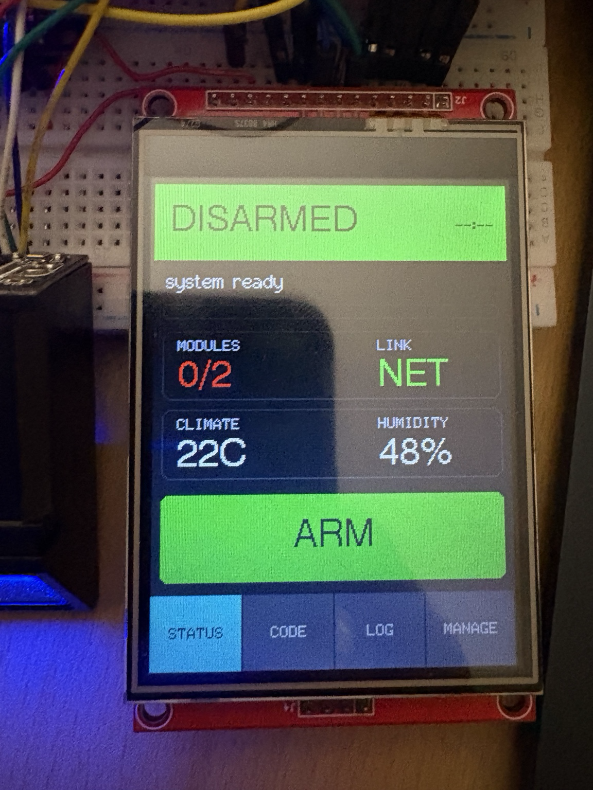
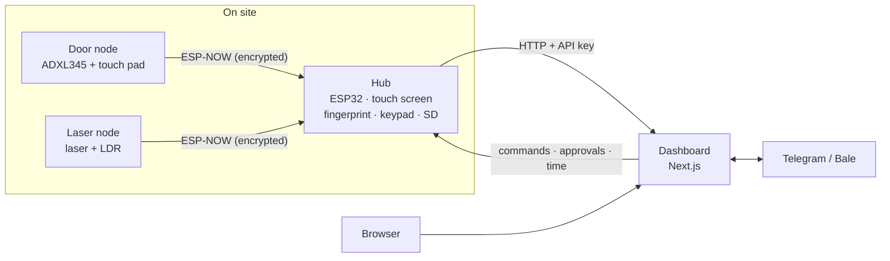
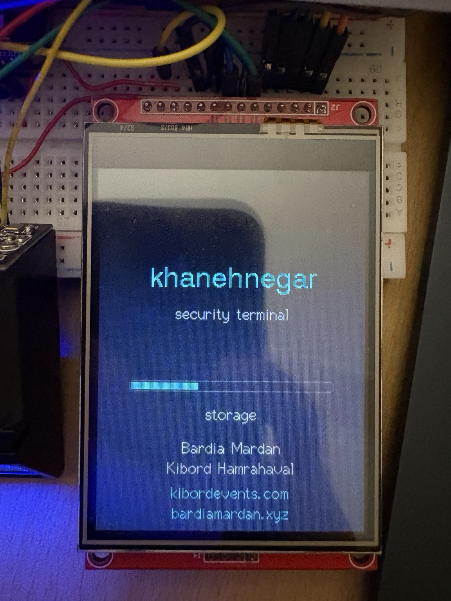
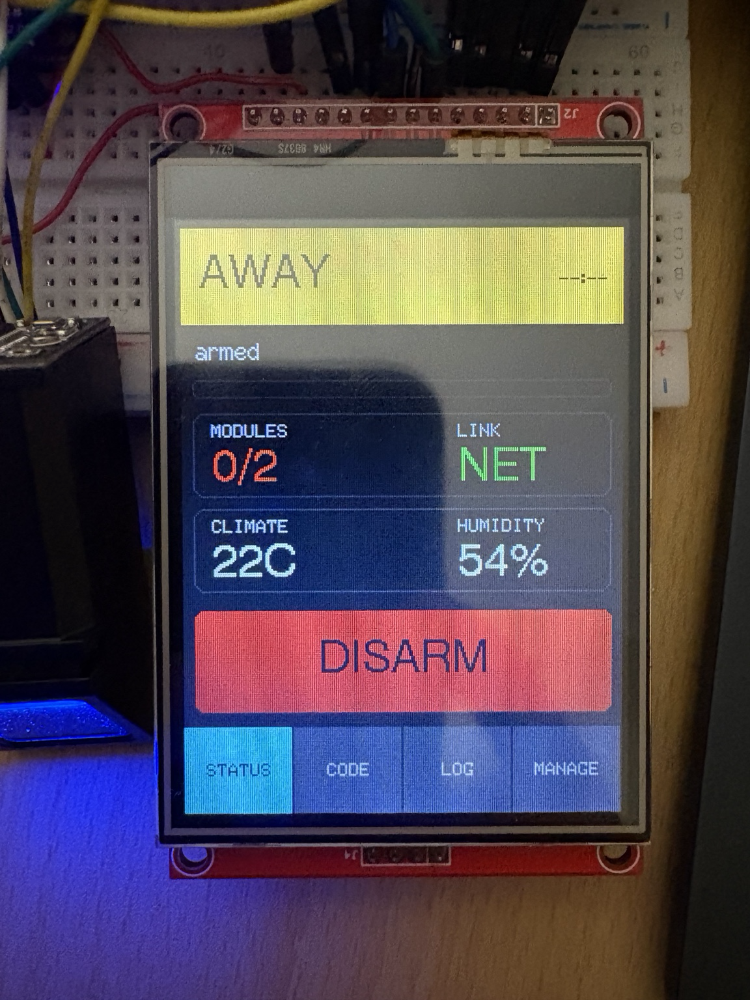
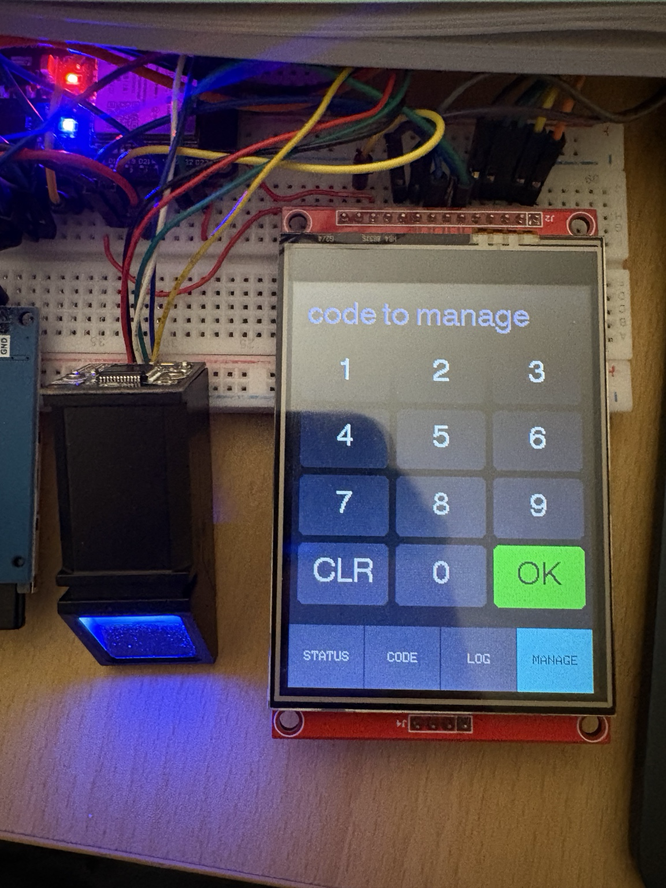
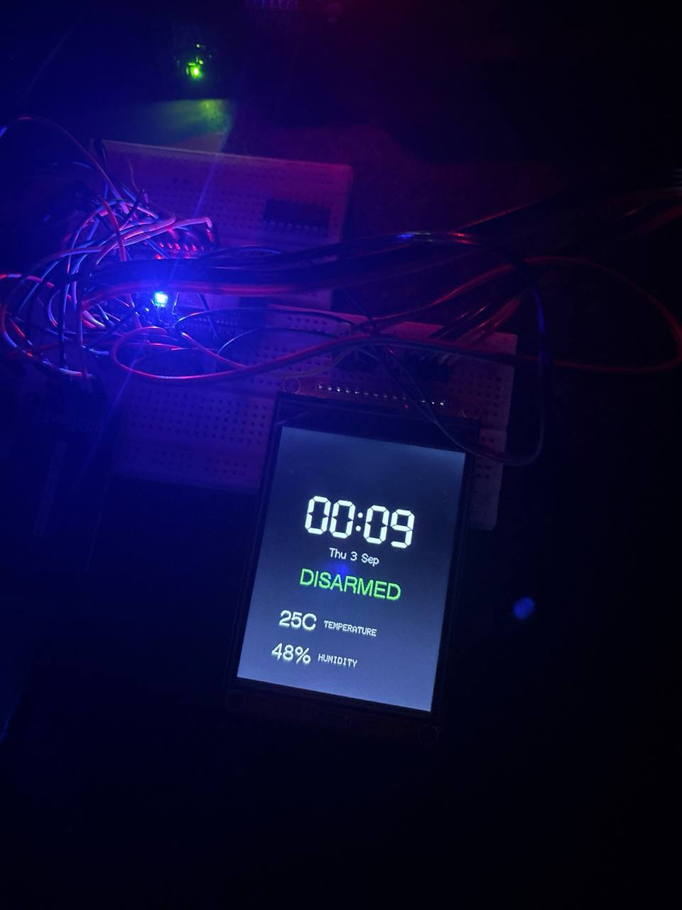

<div align="center">

# khanehnegar · خانه‌نگار

**A modular, self-hosted home security system built on ESP32.**
Encrypted wireless sensors, a fingerprint and touch-screen terminal that decides on its own, and a bilingual web dashboard with Telegram and Bale alerts.

[](https://github.com/BardiaMardan/khanehnegar-security/actions/workflows/ci.yml)
[](LICENSE)


**English** · [فارسی](README.fa.md)



</div>

---

## Contents

- [What it is](#what-it-is)
- [Features](#features)
- [How it works](#how-it-works)
- [Hardware](#hardware)
- [Repository layout](#repository-layout)
- [Quick start](#quick-start)
- [Documentation](#documentation)
- [Design decisions](#design-decisions)
- [Security model & limitations](#security-model--limitations)
- [Roadmap](#roadmap)
- [Background](#background)
- [Credits](#credits) · [License](#license)
- [Gallery](#gallery)

---

## What it is

*khanehnegar* (Persian for "house watcher") is a complete alarm system you build yourself from common, inexpensive parts.

Small **sensor nodes** sit on doors and across hallways and report what they feel over encrypted ESP-NOW radio. A **hub**, an ESP32 with a 2.8" touch screen, fingerprint reader, and keypad, weighs that evidence and decides whether to sound the siren, alert you **silently**, or just write it down. A **web dashboard** on your own machine keeps the history, relays commands, and pushes alarms to your phone.

The hub doesn't need the internet, a cloud account, or even the dashboard to protect the house. Everything else is optional.

## Features

**Hub terminal**
- 2.8" touch UI: status, keypad, event log, management, and a standby clock
- Disarm by **fingerprint** (R307/R308) or a **keypad code**, stored as a salted SHA-256 and compared in constant time
- **Lockdown** after 5 wrong codes. It survives reboots and is cleared only by a known finger or remotely.
- **Risk-fusion engine** with *loud* and *silent* evidence, plus exit and entry delays
- Armed state survives power cuts. A 40-event journal in flash, plus a full CSV history on SD.
- Network I/O on its own core, so a dead server never freezes the screen

**Sensor nodes**
- **Door**: an accelerometer detects opening (tilt), forcing, and impact. A capacitive pad on the handle is a *silent* trigger.
- **Laser tripwire**: a strobed beam measured lit-minus-dark, so ambient light and torches can't mask a break
- Heartbeats every 5 s. A destroyed or unplugged node raises **MODULE LOST** within 13 s.

**SecMesh radio library**
- ESP-NOW with CCMP encryption, a per-node replay counter, and MAC filtering
- Broadcast pairing handshake, automatic channel hunting, and reboot-tolerant counters
- Urgent frames sent 3× and de-duplicated, so a lost packet can't lose an alarm

**Dashboard**
- Next.js 15, **Persian (RTL) and English**, mobile-first
- Live event feed, plus remote **arm / disarm / panic / lock / unlock**
- Fingerprint roster: rename from the web, while **removal must be approved at the terminal**
- **Telegram and Bale** alerts and bot commands
- Single-admin login (better-auth): sign-up disabled, rate-limited

## How it works



1. A node notices something and sends it **three times**, encrypted.
2. The hub drops duplicates and replays, then **scores** the event. Strong evidence, like a door opening or a cut beam, reaches the alarm threshold on its own. Weak evidence has to add up.
3. **Loud** evidence sounds the siren. **Silent** evidence, like a hand on the handle or a node being tampered with, only alerts your phone, so the intruder doesn't know they were seen.
4. The hub posts the alert to the dashboard, which saves it and forwards it to Telegram and Bale.
5. Every 5 s the hub **polls** the dashboard for commands, so no port on your network is ever opened inward.

Full diagrams and reasoning: **[docs/architecture.md](docs/architecture.md)**.

## Hardware

| Board | Parts |
|---|---|
| **Hub** | ESP32 DevKit · 2.8" ILI9341 SPI touch screen · R307/R308 fingerprint sensor · microSD module · DHT11 · buzzer |
| **Door node** | ESP32 · ADXL345 accelerometer · a wire to the door handle |
| **Laser node** | ESP32 (LilyGO T-Display) · laser module · LDR + 10 kΩ · LED |

All three boards use breadboards and jumper wires, with no soldering. Wiring tables and the BOM are in **[docs/hardware.md](docs/hardware.md)**.

## Repository layout

```
khanehnegar-security/
├── firmware/
│   ├── hub/                 the terminal: state machine, access, UI, network
│   │   ├── config.h         every tunable in one place
│   │   └── src/ui/          touch-screen pages
│   ├── node-door/           accelerometer + handle-touch node
│   └── node-laser/          strobed laser tripwire node
├── libraries/SecMesh/       encrypted ESP-NOW transport shared by all boards
├── dashboard/               Next.js web app + API for the hub
│   ├── app/api/             hub and browser endpoints
│   └── lib/                 auth, command queue, bots, i18n
├── sdcard-example/khaneh/   config.ini + access.ini template for the hub's SD card
├── TFT_eSPI_User_Setup.h    display pin map for the TFT_eSPI library
└── docs/                    architecture, tutorials, reference, images
```

## Quick start

You'll need the hardware above, the Arduino IDE 2 or `arduino-cli`, and Node.js 22.

| Step | Tutorial |
|---|---|
| **1.** Wire the hub, install the ESP32 core and libraries, set your keys, and flash it | [01 · Hub](docs/tutorials/01-hub.md) |
| **2.** Put your Wi-Fi and dashboard address on an SD card | [02 · SD card](docs/tutorials/02-sd-card.md) |
| **3.** Build the door node and pair it | [03 · Door node](docs/tutorials/03-door-node.md) |
| **4.** Build the laser tripwire and pair it | [04 · Laser node](docs/tutorials/04-laser-node.md) |
| **5.** Install and start the dashboard | [05 · Dashboard](docs/tutorials/05-dashboard.md) |
| **6.** Connect Telegram and/or Bale | [06 · Alerts](docs/tutorials/06-alerts.md) |
| **7.** Change the code, enrol fingers, and test every alarm path | [07 · First run](docs/tutorials/07-first-run.md) |

The short version for the dashboard:

```bash
cd dashboard
cp .env.example .env.local      # fill in HUB_API_KEY, BETTER_AUTH_SECRET, ADMIN_*
npm ci
npm run setup                   # creates the database and your account
npm run dev                     # http://<your-lan-ip>:3000
```

## Documentation

| | |
|---|---|
| **Tutorials** | [Hub](docs/tutorials/01-hub.md) · [SD card](docs/tutorials/02-sd-card.md) · [Door node](docs/tutorials/03-door-node.md) · [Laser node](docs/tutorials/04-laser-node.md) · [Dashboard](docs/tutorials/05-dashboard.md) · [Alerts](docs/tutorials/06-alerts.md) · [First run](docs/tutorials/07-first-run.md) |
| **Architecture** | [How the parts fit, modes, alarm flow, design decisions](docs/architecture.md) |
| **Hardware** | [BOM, wiring tables, pin choices](docs/hardware.md) |
| **Protocol** | [SecMesh frame, pairing, replay protection, event codes, writing a node](docs/protocol.md) |
| **API** | [Every dashboard endpoint, with examples](docs/api.md) |
| **Configuration** | [SD card, `config.h`, node tuning, `.env`](docs/configuration.md) |
| **Security** | [Threat model, defences, limitations, hardening checklist](docs/security.md) |
| **Deployment** | [Moving the dashboard to a Raspberry Pi, home server, or VPS](docs/deployment.md) |
| **Troubleshooting** | [Common problems and FAQ](docs/troubleshooting.md) |

## Design decisions

The short version. Each point is argued in full in [architecture.md](docs/architecture.md#design-decisions).

- **ESP-NOW instead of Wi-Fi or MQTT for sensors.** Nodes don't depend on your router, reconnect in milliseconds, and get link-layer encryption without a TLS stack.
- **The hub decides, nodes only report.** Credentials and the alarm logic live in one place, on one thread.
- **Loud vs silent evidence.** A siren protects property but also warns the intruder. Some signals are worth more kept secret.
- **One strong event is enough.** Real intrusions rarely produce several weak signals, so a door opening or a cut beam trips the alarm by itself. Fusion handles the weak ones.
- **Destructive web actions need the panel.** A stolen dashboard password can't remove your fingerprint.
- **The hub polls, nothing connects in.** No port forwarding and no fixed IP for the hub.
- **Security state in flash, convenience on SD.** Pulling the SD card can't change who's allowed in.

## Security model & limitations

khanehnegar is a carefully built hobby system, **not a certified alarm**. Here is what it does and doesn't do:

| ✅ Defends against | ⚠️ Does not defend against |
|---|---|
| Doors forced or opened, beams crossed | RF jamming: detected in 13 s, but alerts need the network |
| Sniffing, forging, or replaying sensor frames (ESP32) | Power cuts: there's no battery in the reference build |
| Destroying or unplugging a node | Internet outages: the siren still works, remote alerts don't |
| Brute-forcing the code; random fingers | ESP8266 nodes: plaintext on air, by necessity |
| Power-cycling to disarm or reset attempts | One shared key per site: one node's flash reveals it |
| Pulling the SD card | Hub ↔ dashboard is plain HTTP unless you add HTTPS |
| A stolen dashboard password removing credentials | Anyone logged in, or in the bot chat, *can* disarm |

The full threat model, every defence with the code that implements it, and a hardening checklist are in **[docs/security.md](docs/security.md)**. To report a vulnerability, see [SECURITY.md](SECURITY.md).

## Roadmap

- [ ] Battery backup and low-supply reporting (`EV_LOW_SUPPLY` is already in the protocol)
- [ ] Window (reed switch), PIR, and glass-break nodes (codes reserved)
- [ ] RF decoy node that detects deauth floods and jamming (`EV_RF_*` reserved)
- [ ] Re-send alerts raised while the hub was offline
- [ ] HTTPS with certificate pinning from hub to dashboard
- [ ] Per-node keys instead of one site key
- [ ] Move dashboard events from JSON to SQLite
- [ ] HOME mode from the panel (perimeter only)
- [ ] 3D-printable enclosures

Ideas and pull requests are welcome. See [CONTRIBUTING.md](CONTRIBUTING.md).

## Background

khanehnegar was designed and built in about a week (30 August to 7 September 2026) as a project for the **Kibord Hamrahaval** academy. The first version unlocked with an RFID card; a fingerprint sensor replaced it on day two, and the dashboard, bots, and laser node followed. The [changelog](CHANGELOG.md) and git history record how it got here, including the parts that didn't work the first time. Many of the "why" comments in the code, and the [troubleshooting](docs/troubleshooting.md) page, come from those failures.

What the project explores:
- **Embedded systems design**: dual-core FreeRTOS, a single-owner state machine, flash wear, and failure modes
- **Wireless security**: link-layer encryption, replay protection, liveness detection, and their trade-offs
- **Full-stack integration**: a microcontroller and a web app cooperating with no inbound connections
- **Security UX**: silent alarms, approval at the panel, and countdowns that don't help an intruder

## Credits

Designed and built by **[Bardia Mardan](https://bardiamardan.xyz)** for **[Kibord Hamrahaval](https://kibordevents.com)**.

Built with [TFT_eSPI](https://github.com/Bodmer/TFT_eSPI), [Adafruit Fingerprint](https://github.com/adafruit/Adafruit-Fingerprint-Sensor-Library), [DHT sensor library](https://github.com/adafruit/DHT-sensor-library), [Next.js](https://nextjs.org), [better-auth](https://www.better-auth.com), and [Vazirmatn](https://github.com/rastikerdar/vazirmatn).

## License

[MIT](LICENSE) © 2026 Bardia Mardan

---

## Gallery

<table>
  <tr>
    <td align="center" width="50%">
      <br>
      <sub><b>Boot.</b> The splash screen steps through storage, radio, fingerprint, sensors, and network.</sub>
    </td>
    <td align="center" width="50%">
      <br>
      <sub><b>Disarmed.</b> Modules online, Wi-Fi link, temperature and humidity, one-tap ARM.</sub>
    </td>
  </tr>
  <tr>
    <td align="center">
      <br>
      <sub><b>Armed (AWAY).</b> The banner turns yellow and the action becomes DISARM.</sub>
    </td>
    <td align="center">
      <br>
      <sub><b>Manage, behind the code.</b> The fingerprint sensor sits to the left.</sub>
    </td>
  </tr>
  <tr>
    <td align="center" colspan="2">
      <br>
      <sub><b>Standby.</b> After a minute idle, the terminal switches to a clock with the mode and climate.</sub>
    </td>
  </tr>
</table>
