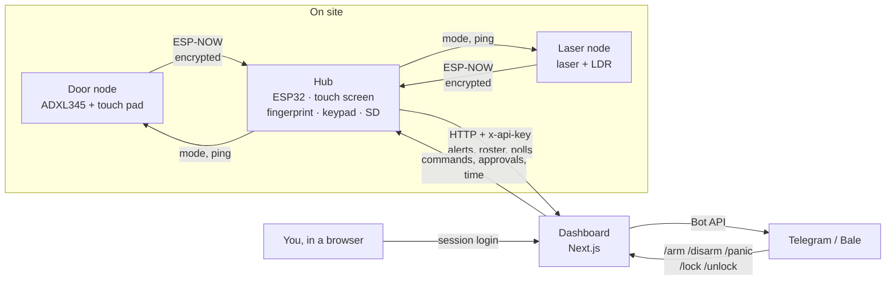
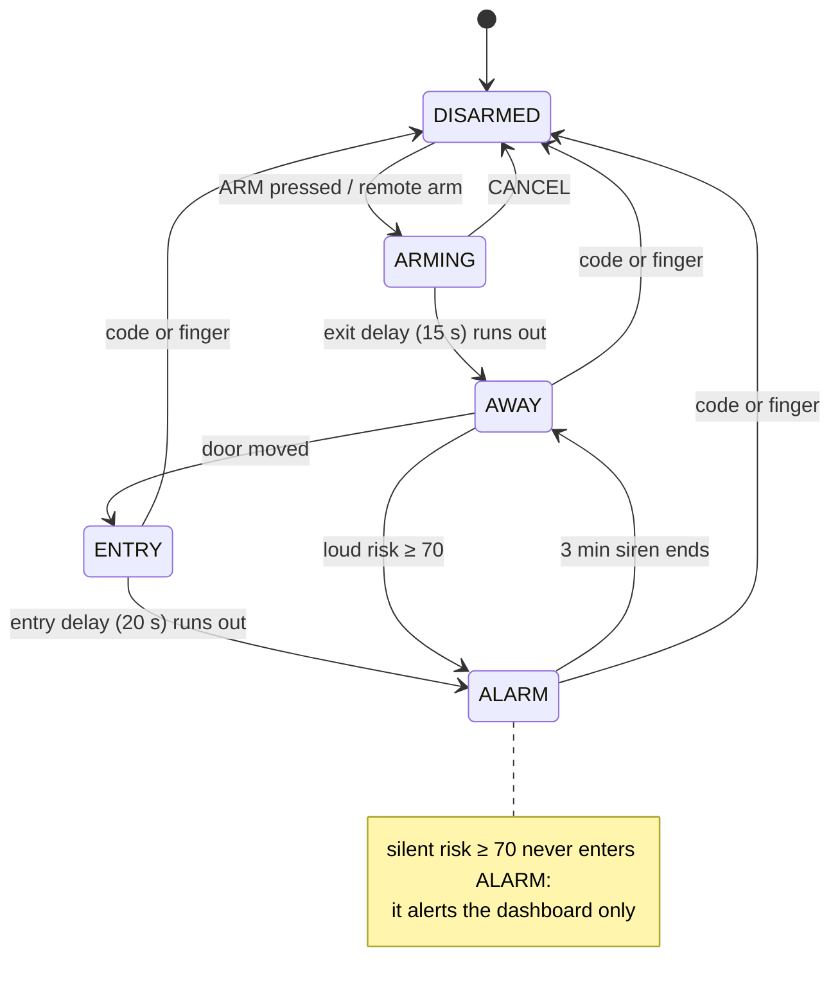
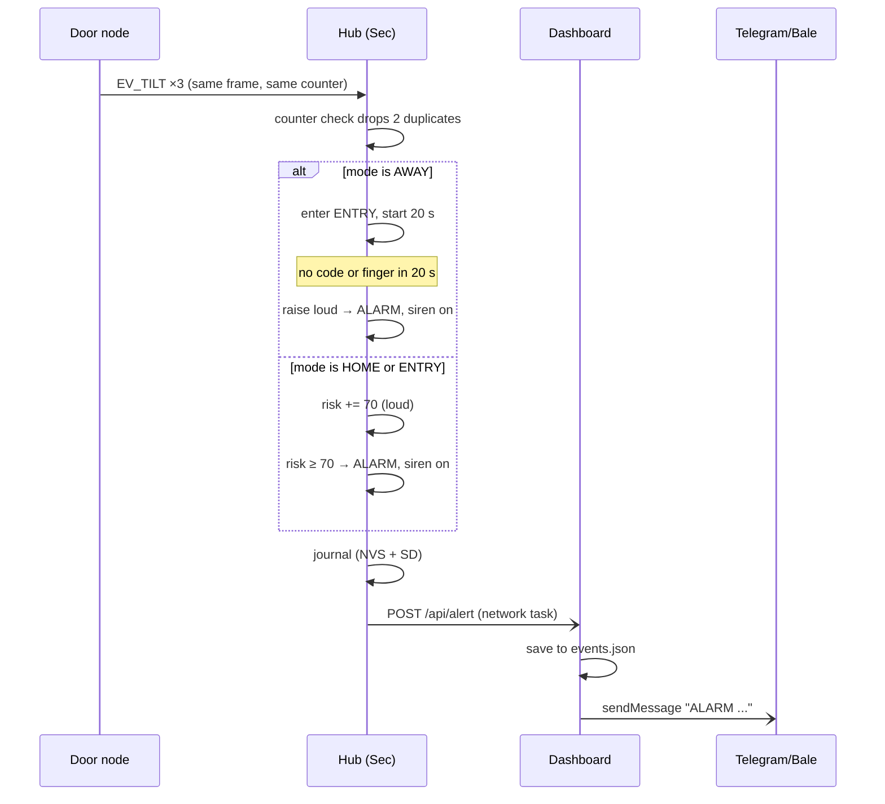
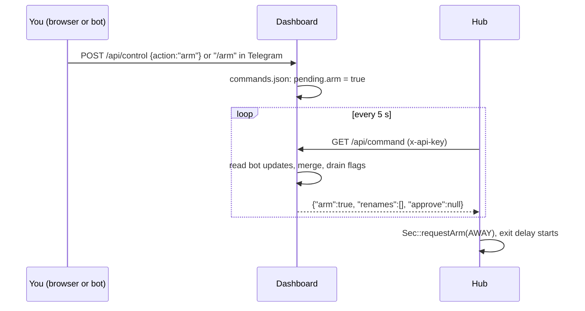
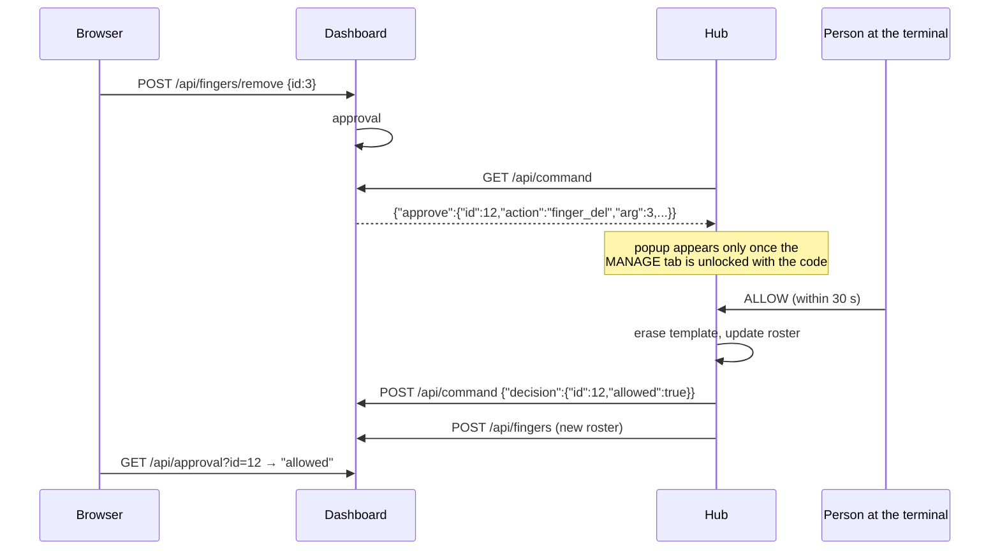

# Architecture

khanehnegar has four parts. Each one does one job.

| Part | Runs on | Job |
|---|---|---|
| **Hub** (`firmware/hub/`) | ESP32 + 2.8" touch screen | Decides. Fuses evidence into alarms, owns every credential, and is the only thing that can disarm. |
| **Nodes** (`firmware/node-*/`) | ESP32 per sensor | Notice. They report raw events and decide nothing. |
| **SecMesh** (`libraries/SecMesh/`) | Every board | Carries encrypted, replay-checked frames between nodes and the hub over ESP-NOW. |
| **Dashboard** (`dashboard/`) | Any machine with Node.js | Reports and relays. Event history, remote commands, and Telegram/Bale alerts. It never holds authority the hub hasn't granted. |

---

## The hub

The hub sketch is split into modules. Each module is a C++ `namespace` with a single owner of its state.

| Module | File | Owns |
|---|---|---|
| `Sec` | `state.cpp` | The arm mode, risk scores, and every alarm decision. **The only place the mode changes.** |
| `Access` | `access.cpp` | The keypad code (salted SHA-256 in NVS), the lockdown latch, the manage session, and pending web approvals |
| `Fingers` / `FP` | `fingers.cpp`, `fp.cpp` | Which sensor template IDs are people (NVS), and the R308 sensor driver |
| `Nodes` | `nodes.cpp` | Adopted modules, replay counters, and liveness |
| `Journal` | `journal.cpp` | The last 40 events in NVS, plus an unbounded CSV on the SD card |
| `Store` | `store.cpp` | The SD card, `config.ini`, and the clock |
| `Net` | `net.cpp` | Wi-Fi and every HTTP call, on its own FreeRTOS task |
| `UI` | `src/ui/` | The touch screen: pages, toasts, standby, and the approval popup |
| `IO`, `Climate` | `io.cpp`, `climate.cpp` | Buzzer/siren and DHT11 |

### Threads

The ESP32 has two cores, and the hub uses both:

- **Core 1, main loop**: UI, fingerprint, nodes, state machine. Every `Sec::` call happens here, so the state machine never has to lock anything.
- **Core 0, network task**: every blocking socket call. It talks to the main loop through two FreeRTOS queues of fixed-size structs (`OutMsg`, `InMsg`) copied by value. A slow or dead server can never freeze the touch screen.
- **ESP-NOW receive callback**: runs in the Wi-Fi task and only pushes frames into a 12-slot ring buffer (`hub.ino`). The main loop drains it.

### Persistence

| What | Where | Why there |
|---|---|---|
| Keypad code hash + salt, lockdown flag | NVS | Survives power loss. Pulling the plug does not reset the guess counter. |
| Arm mode (DISARMED/HOME/AWAY) | NVS | A power cut does not disarm the house. ALARM and ENTRY come back as AWAY. |
| Fingerprint roster | NVS, mirrored to `access.ini` | A missing SD card must never decide whether a finger is known. |
| Adopted nodes (MAC, kind, encrypted?) | NVS | Restored as *offline* until they speak. |
| Last 40 events | NVS ring | Readable on the LOG page with no card. |
| Full event archive | `/khaneh/events.csv` on SD | Unbounded history. |
| Wi-Fi, server URL, API key | `/khaneh/config.ini` on SD, falling back to `secrets.h` | Change the network without reflashing. |
| Touch-screen calibration | NVS | Asked for once, on first boot. |

---

## Modes

`LOCKDOWN` is not a mode. It is a latch in `Access` that sits on top of any mode. It is set after 5 wrong codes or by the `/lock` command. While it is set, the keypad is refused. It is cleared only by a known fingerprint or the `/unlock` command, and it survives reboots.

`HOME` exists in the protocol and is restored after a power cut, but the reference UI arms straight to `AWAY`.

---

## How an alarm happens

Nodes never raise alarms. They report what they saw. The hub scores the evidence:

### Risk fusion

Every event has a **weight** and a **class** (`scoreFor()` in `state.cpp`). The hub keeps two running scores:

- `risk`: everything
- `loudRisk`: loud evidence only

Both lose 3 points per second. When `risk` reaches 70, the hub raises the alarm. If `loudRisk` is also at 70, the siren sounds. Otherwise the alarm is **silent**: it is logged and sent to your phone, and the house stays quiet.

| Event | Weight | Class | Reasoning |
|---|---|---|---|
| Door movement, forcing, impact, beam cut, glass | 70 | loud | An intruder does each of these once. One is enough. |
| Handle touched | 70 | **silent** | Someone is at the door. Don't tell them they've been seen. |
| Hand approaching | 35 | silent | Needs a second piece of evidence. |
| Node case opened, deauth flood, RF jam | 80 | silent | Sabotage. Alert, but don't reveal you noticed. |
| Module lost (no heartbeat for 13 s) | 75 | silent | A node going quiet may mean it was destroyed. |
| 5 wrong codes / 3 unknown fingers in 60 s | 70 | silent | Code attack. |
| Motion | 30 | loud | Weak on its own. |

Panic and opening the hub case while armed set both scores to the maximum.

When the system is disarmed, node events are journaled but never scored. Jamming, deauth, and panic are the exceptions and are scored in any mode.

---

## Remote commands

The hub sits behind your router, so the dashboard cannot reach it. Instead, the hub **polls** every 5 seconds:

Bot updates are fetched *during the hub's poll*, not by a webhook. This keeps the dashboard reachable from your LAN only. The trade-off is up to 5 seconds of latency.

## Web actions that need the terminal's approval

Destructive changes asked for on the web (removing a fingerprint, and on the hub side also wiping all fingers or forgetting all nodes) are **proposed, not executed**. A stolen dashboard password cannot remove your fingerprint from the system.

---

## Design decisions

### ESP-NOW, not Wi-Fi or MQTT, between nodes and hub
Nodes don't join your Wi-Fi, so they don't depend on your router, its DHCP, or its uptime. A node rebooting is back in milliseconds, not seconds. Frames are encrypted by the radio (CCMP) with no TLS stack on the node. The cost is range: ESP-NOW is single-hop, so every node must be in radio range of the hub.

### Two classes of evidence, loud and silent
A siren protects property but also tells an intruder they've been seen. Some signals are much more useful kept secret: a hand on the handle, a node's case being opened, jamming. Silent evidence can never sound the siren. It alerts you and leaves the intruder unaware.

### One event can reach the threshold on its own
The engine is built to *fuse*, but early tests showed real break-ins rarely produce several weak signals. Nobody opens a door twice. Strong evidence is weighted to trip alone, and fusion still matters for weak signals like hand-approaching and motion.

### Three copies of every urgent frame
Nodes send each alarm frame 3 times, 40 ms apart, with the **same** counter. A single lost packet cannot lose an alarm, and the hub's replay check silently drops the duplicates. Building a new frame per copy would have scored one touch three times.

### Every heartbeat is answered
Nodes send a heartbeat every 5 s and the hub replies to each one. A node that hears nothing for 30 s assumes it has lost the hub and hops channels to find it. Without the reply, healthy nodes would hop away from a working link. The hub marks a node dead after 13 s, 2.5 missed heartbeats. That's short on purpose, because a node that goes quiet may have been destroyed.

### Destructive web actions need the terminal
The dashboard is the most exposed component. It holds no authority to remove credentials. It can only *ask*, and someone who knows the code must approve at the panel within 30 seconds.

### The hub polls, the dashboard never connects in
The hub needs no open port and no fixed IP. The dashboard can live anywhere the hub can reach.

### JSON files for dashboard state
Events (last 500), commands, and the finger roster are small JSON files under `dashboard/data/`. With one hub and one user there is no contention. Writes go through a promise chain so concurrent requests can't interleave. Accounts and sessions use SQLite through better-auth. See the [roadmap](../README.md#roadmap) for moving events to SQLite.

### SD card for configuration, NVS for security state
The SD card is convenient for anything you might change, like Wi-Fi. Anything security-relevant (the code, the roster, the lockdown flag, the arm mode) lives in the ESP32's flash, so pulling the card can't change who is allowed in.

### ESP8266 nodes run plaintext
See [security.md](security.md#esp8266-nodes).
