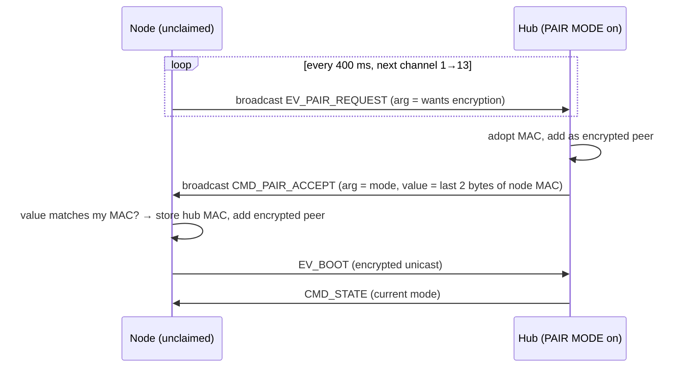

# SecMesh protocol

SecMesh is the radio layer shared by the hub and every node, in [`libraries/SecMesh/`](../libraries/SecMesh/).
It is a single Arduino library that runs on ESP32 and ESP8266.

## Transport

- **ESP-NOW**, on channel 1 by default (`SECMESH_CHANNEL`). Once the hub joins Wi-Fi, it follows the router's channel, and nodes find it by hopping channels.
- **Encryption**: ESP-NOW's built-in CCMP. The PMK encrypts the LMK exchange, and the LMK encrypts unicast frames. Both are 16-byte keys in `SecMeshKeys.h`, shared by every board on the site.
- **Broadcast** frames (pairing only) are never encrypted. ESP-NOW can't encrypt broadcasts.

## The frame

Every frame is 15 bytes, packed, little-endian:

| Offset | Field | Type | Meaning |
|---|---|---|---|
| 0 | `magic` | u16 | `0x4B4E` ("KN"). Anything else is dropped. |
| 2 | `version` | u8 | `SECMESH_VERSION` (1). A mismatch is dropped. |
| 3 | `kind` | u8 | Sender's [node kind](#node-kinds) |
| 4 | `counter` | u32 | Increments on every frame the sender builds. Used for replay protection. |
| 8 | `code` | u8 | An [event](#events-node--hub) or a [command](#commands-hub--node) |
| 9 | `arg` | u8 | Code-specific, e.g. the arm mode |
| 10 | `value` | u16 | Code-specific, e.g. impact in centi-g, angle in degrees |
| 12 | `supplyMv` | u16 | Sender's supply voltage, if it measures it |
| 14 | `flags` | u8 | `0x01` tamper open · `0x02` low battery · `0x04` paired |

Changing this layout or the meaning of any code is a **protocol break**. Bump `SECMESH_VERSION` and reflash every board.

## Pairing



- The accept is **broadcast** because the node can't receive encrypted unicast from a peer it hasn't added yet. It carries no secret, and names its target by MAC tail.
- PAIR MODE on the hub closes automatically after 2 minutes. While it's closed, the hub ignores requests from MACs it doesn't know. **A MAC the hub already knows is re-accepted at any time**, so a rebooted node rejoins without anyone touching the panel.
- The hub stores up to `SECMESH_MAX_NODES` (6) nodes in NVS.
- The node stores its hub's MAC in NVS (ESP32) or EEPROM (ESP8266). The door node clears it on every boot (`ALWAYS_UNCLAIM`) so it hunts quickly. The laser node keeps it, and clears it if GPIO 0 is held low at boot.

## Replay protection

The hub keeps the last counter it accepted from each node and accepts a frame only if its counter is **strictly greater**. There are two exceptions:

- `EV_BOOT` resets the stored counter, because a node restarts its counter at 1 after a power cut.
- A counter of 8 or less, or one that jumped back by more than 1000, is treated as a reboot too. Otherwise a rebooted node would stay mute until its counter caught up, and in a security system a silent node is the worst failure. An attacker would have to replay one of the first 8 frames after a reboot, and the next genuine frame resynchronises past it.

## Liveness

| Constant | Value | Meaning |
|---|---|---|
| `SECMESH_HEARTBEAT_MS` | 5000 | A node sends `EV_HEARTBEAT` this often |
| `SECMESH_DEAD_MS` | 13000 | The hub marks a node dead after this much silence, and raises `EV_NODE_LOST` |
| `SECMESH_SILENT_MS` | 30000 | A node that hears no reply for this long hops channel and re-pairs |
| `SECMESH_ALARM_REPEAT` / `_GAP_MS` | 3 / 40 | Urgent frames are sent three times, 40 ms apart, with the same counter |

The hub answers every heartbeat with `CMD_PING`, which carries the current mode. That reply is how a node knows the link works in both directions. A pair request does **not** count as proof of life. Only an accepted data frame does.

## Events (node → hub)

| Code | Name | Sent by | Notes |
|---|---|---|---|
| 1 | `EV_PAIR_REQUEST` | any node | broadcast |
| 2 | `EV_HEARTBEAT` | any node | every 5 s |
| 3 / 4 | `EV_TAMPER_OPEN` / `_CLOSED` | laser node, hub | case switch |
| 5 | `EV_LOW_SUPPLY` | | reserved |
| 6 | `EV_BOOT` | any node | after a (re)claim; resets the replay counter |
| 10 | `EV_PRETOUCH` | | reserved, hand approaching |
| 11 | `EV_TOUCH` | door | handle touched, **silent** |
| 12 | `EV_IMPACT` | door | `value` = magnitude ×100 g |
| 13 | `EV_AGITATION` | door | 10 vibrations within 3 s: door being forced |
| 14 / 15 | `EV_DOOR_OPEN` / `_CLOSED` | | reserved, reed switch |
| 16 | `EV_GLASS` | | reserved |
| 17 | `EV_LASER_CUT` | laser | `value` = contrast at the break |
| 18 | `EV_MOTION` | | reserved, PIR |
| 19 | `EV_TILT` | door | door moved. `value` = degrees |
| 20–22 | `EV_RF_PROBE` / `_DEAUTH` / `_JAM` | | reserved, decoy node |
| 23 | `EV_NODE_LOST` | hub (internal) | |
| 30–44 | `EV_PANIC` … `EV_FINGER_RENAMED` | hub (internal) | journal-only events: access, arming, lockdown, roster changes |

"Reserved" codes have an assigned weight in the hub's risk table, so a new node type can use them without touching the hub.

## Commands (hub → node)

| Code | Name | `arg` | Effect |
|---|---|---|---|
| 1 | `CMD_PAIR_ACCEPT` | mode | completes pairing (broadcast) |
| 2 | `CMD_STATE` | mode | mode changed, or the node came back |
| 3 | `CMD_PING` | mode | heartbeat reply |
| 4 | `CMD_IDENTIFY` | | laser node blinks its LED |

## Modes

`0` DISARMED · `1` HOME · `2` AWAY · `3` ENTRY · `4` ALARM · `6` LOCKDOWN (display only)

## Node kinds

`0` HUB · `1` DOOR · `2` WINDOW · `3` LASER · `4` DECOY · `5` PANEL (remote keypad)

The hub adopts only DOOR, WINDOW, LASER, and PANEL.

## Writing a new node

```cpp
#include <SecMesh.h>

static uint8_t hubMode = MODE_DISARMED;

static void onRx(const uint8_t mac[6], const SecFrame &f) {
  if (f.code == CMD_PAIR_ACCEPT && SecMesh.onPairAccept(mac, f)) { hubMode = f.arg; SecMesh.send(EV_BOOT); }
  if (f.code == CMD_STATE || f.code == CMD_PING) hubMode = f.arg;
}

void setup() {
  SecMesh.begin(KIND_WINDOW, onRx);
  SecMesh.loadClaim();
  if (SecMesh.hasHub()) SecMesh.send(EV_BOOT);
}

void loop() {
  SecMesh.tick();                              // pairing, heartbeat, tamper
  if (windowOpened()) SecMesh.sendUrgent(EV_DOOR_OPEN);
}
```

Report what you see and let the hub decide. A node should never ignore an event because it thinks the system is disarmed.
